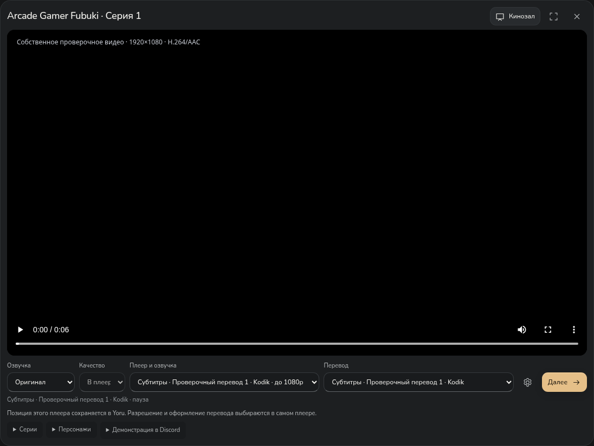

# Yoru — кино, сериалы и аниме


**Windows 10/11 · x64 · версия 0.9.1**

Три раздела в одном приложении: **Аниме / Фильмы / Сериалы**. Поиск, жанры, избранное, библиотека, темы и сохранение позиции встроенного просмотра.

Для аниме AniLibria доступен встроенный плеер и автоматический подбор дополнительных озвучек/переводов Yummyani для сопоставленного релиза. Выбранный онлайн-плеер открывается на странице просмотра Yoru. Сам расширенный каталог Yummyani по-прежнему можно открыть в отдельном окне. Для фильмов и сериалов доступны каталог метаданных и поиск в **YouTube, Кинопоиске, Rutube, VK Видео** в системном браузере. Это поиск на сервисах: наличие полной версии и региональные ограничения определяет сайт. Подтверждённые прямые файлы Internet Archive можно смотреть внутри приложения с резервными адресами того же файла.



Новые киносервисы пока **не подтверждены живой проверкой из РФ и других стран**. В этой облачной среде их домены отклоняются прокси; сетевой черновик сохранён и ожидает публикации. Тесты с контролируемыми ответами проверяют приложение, но не заменяют проверку внешнего видео.

## Установка

**[Скачать установщик Yoru 0.9.1](https://github.com/Duwkaf1/kinoteatr-xivivide/actions/runs/41237752875/artifacts/13056820249)** — около 104 MiB. Извлеки `Yoru-Setup-0.9.1-x64.exe` из ZIP GitHub, закрой прежний Yoru и нажми **«Установить»**. Установщик автономный, на русском, без прав администратора; библиотека и настройки сохраняются. Для загрузки артефакта GitHub нужен вход в аккаунт.

[Инструкция](docs/installer.md) · [ZIP без установки](https://github.com/Duwkaf1/kinoteatr-xivivide/actions/runs/41237752875/artifacts/13056755428) · [Успешная Windows-проверка](https://github.com/Duwkaf1/kinoteatr-xivivide/actions/runs/41237752875)

## Оригинал, переводы и персонажи 0.9.1

Под видео выбери **«Озвучка → Оригинал»**, затем реальный вариант в **«Перевод»**. Поле **«Плеер и озвучка»** появляется, когда у серии есть несколько вариантов. Названия студий и команд берутся из API; вставлять ссылки не требуется. AniLibria начинает играть сразу, другие варианты подбираются в фоне. При восстановлении выбранного оригинала другой русский дуб не включается на время ожидания.

[Снимок страницы просмотра](docs/images/automatic-player.png) использует собственный тестовый ролик и контролируемые варианты, не живое видео аниме.

У онлайн-плеера разрешение и оформление субтитров выбираются **в самом плеере**. Yoru показывает «В плеере»; подтверждённое API максимальное разрешение указано в подписи варианта. Встроенные основной/альтернативный движки, прямые видео и оформленные субтитры сохранены. Kodik передаёт подтверждённый тайминг в историю; плеерам без такого интерфейса сохранение времени не приписывается.

Персонажи и фотографии для сопоставленного релиза загружаются с публичной страницы **AniDB автоматически**, без XML и регистрации API-клиента пользователем. Главные роли идут перед второстепенными. Свои имена и заметки сохраняются. Поэпизодное появление каждого персонажа не выдумывается: автоматический список относится к релизу/сезону.


Для **«Чёрного Клевера (Спэшл)», AniLibria 5152**, проверен настоящий ответ: только **720p/480p**, 1080p у этого источника нет. Также исправлена отдельная ошибочная связь карточки с другим спин-оффом. У другого плеера 1080p доступно только если оно действительно опубликовано. [Данные проверки](docs/black-clover-0.9.1.json).

**Живая проверка дополнительных озвучек, субтитров и текущего HTML AniDB ещё не завершена:** облачный прокси отклоняет эти домены на CONNECT (403). Сетевой черновик сохранён и требует публикации в настройках среды. Контролируемые тесты проверяют код, а не наличие оригинала/переводов у каждого аниме. [Подробности и ограничения 0.9.1](docs/anime-automatic-0.9.1.md).

## Фильмы и сериалы

- Cinemeta: названия, описания, год, жанры, постеры и серии. Список жанров берётся из выбранного каталога.
- При отказе основного каталога — TVmaze для сериалов или Internet Archive для свободных фильмов. Смена источника обозначается; состав каталогов различается.
- Поиск на YouTube, Кинопоиске, Rutube и VK Видео получает название, год и выбранную серию. Переход в браузер позволяет сервису самостоятельно обработать вход, подписку и DRM.
- При недоступности каталога введённое название можно искать сразу на выбранном сервисе.
- Встроенный просмотр Internet Archive предлагается только при подтверждённых метаданных лицензии, языка и подходящего файла. Резервные адреса используют то же имя файла, MD5 и качество; прогресс восстанавливается только для того же файла.
- **Настройки → Дополнительно → Доступ к видеосервисам**: проверка соединения с публичными страницами без учётных данных. Она не подтверждает наличие или воспроизведение конкретного фильма.

**Автоматической передачи тайминга и озвучки между браузерными плеерами этих сервисов нет.** Сервисы выбираются вручную; история встроенного плеера не выдаётся за историю браузера. Доступность всех фильмов и непрерывность просмотра при полном отказе сети не гарантируются.


[Подробности 0.9.0 и ограничения проверки](docs/cinema-0.9.0.md) · [Прямой просмотр свободного фильма — тестовый пример](docs/images/cinema-archive.png) · [Резерв поиска при отказе каталогов](docs/images/cinema-fallback.png)

## Каталог аниме

- Плавный поиск: неподходящие карточки исчезают при вводе, оставшиеся перестраиваются. Уменьшение движения и режим производительности учитываются.
- До шести жанров, возрастной рейтинг, сброс фильтров и случайное аниме со всеми выбранными условиями. Возраст и жанры видны на карточках.
- Выбор между AniLibria и расширенным каталогом Yummyani.
- Поиск по названию, разделы **«Популярное», «Обновления», «Новинки»**, подгрузка следующих карточек.
- Карточка аниме с постером, описанием, жанрами, выбором доступной серии и избранным.
- Автоматическое добавление просмотренного аниме в библиотеку и история с продолжением на сохранённой серии и позиции.
- Основной и альтернативный плееры; переключение сохраняет позицию, паузу и звук.
- Качество выбирается из реально доступных вариантов. Перед повторным открытием обновляются временные адреса видео, чтобы старые ссылки не мешали запуску.
- При ошибке — понятное сообщение и повторная попытка. Отдельной страницы «Источники» с обязательными проверками больше нет.

Для встроенного просмотра подключён **каталог AniLibria/AniLiberty**: в живой проверке 25 октября 2026 года API вернул **1 904 релиза** с русской озвучкой. Это каталог этого провайдера, а не всех аниме мира. Часть релизов может иметь неполный список доступных серий или ограничения; приложение показывает фактическую доступность. Другие студии и оригинальная дорожка не приписываются этому провайдеру.

В поле **«Где искать» → «Yummyani»** доступен дополнительный каталог с поиском, жанрами, возрастами и случайным выбором. Нужная страница открывается кнопкой **«Смотреть на Yummyani»** в отдельном изолированном окне Yoru. Озвучки, серии, субтитры и прогресс там контролирует сайт; синхронизации с таймингом встроенного плеера нет. Точное общее число API этого сайта не сообщает, поэтому показывается число загруженных карточек.


[Фильтры и расширенный каталог](docs/catalog-0.8.1.md). Если постер Yummyani не загрузился, приложение запрашивает резервную обложку AniLibria или MyAnimeList/Jikan по точным идентификаторам релиза. Одного совпадения названия недостаточно: конфликтующие ID и неподтверждённый сезон оставляют заглушку. [Подробности 0.8.2](docs/release-0.8.2.md).


В живой проверке основной CDN намеренно отключён, а метаданные и резервные картинки загружены из настоящих сервисов. Проверены «Фрирен» и «Клинок, рассекающий демонов». Внешние метаданные могут содержать ошибки; автоматический подбор по похожему названию не используется. [Результаты](docs/live-posters-0.8.2.json).


[«Клинок, рассекающий демонов» через альтернативный плеер](docs/images/catalog-live-player-alternative.png) · [Как проверены поиск и фильтры](docs/catalog-0.8.1.md)

## Оформление и удобство

Пять готовых тем — **«Тёплая ночь», OLED, «Север», «Сакура», «Молочный»** — и **«Своя»** с цветами фона, панелей, текста, акцента и формой элементов. Личный выбор сохраняется при переключении тем.

В 0.8.0 исправлены форма и центрирование месяца. Собственная палитра автоматически получает читаемый текст на каждой поверхности, включая поля и боковую панель. Включённое по умолчанию **«Смягчать яркие фоны»** делает большие цветные поверхности спокойнее; переключатель позволяет оставить точные цвета. Исходные значения в палитре сохраняются в обоих случаях, исправление контраста работает всегда.

Ползунок **«Производительность → Баланс → Качество»** плавно следует за мышью и мягко останавливается на выбранном режиме. Клавиатура переключает режимы целиком. Описания не сдвигают ползунок при смене режима на узком окне.

- Производительность отключает декоративные эффекты и анимации, уменьшает количество карточек библиотеки и лимиты памяти медиакомпонентов.
- Качество добавляет мягкие переходы, объём обложек и танцующую пиксельную Мику в индикатор ожидания видео.
- Разрешение видео настраивается отдельно. Изменение оформления не перезапускает текущую серию.
- Локальный шрифт Nunito с кириллицей, SVG-иконки, прокрутка справа, клавиатурный фокус и поддержка уменьшения движения.


[Все 57 скриншотов](docs/images/README.md) · [Плавный ползунок](docs/images/performance-smooth.png) · [Пример формы элементов](docs/images/settings-radius-preview.png)

## Полное удаление

В установленной Windows-версии: **Настройки → Дополнительно → Удалить приложение полностью**. Системное окно перечислит удаляемые данные; по умолчанию выбрана **«Отмена»**. После подтверждения приложение закроется, а деинсталлятор удалит Yoru, библиотеку, историю, заметки, темы и кэш. Вернуть эти локальные данные после удаления нельзя.

Обычное удаление через настройки Windows сохраняет профиль. Посторонние файлы в папке установки и цели ссылок из профиля не удаляются. В ZIP без установщика и при запуске с отдельным профилем полное удаление из приложения недоступно.


## Сохранённые возможности

У каждого аниме свои прогресс, заметки и имена персонажей. Персонажи сопоставленного релиза автоматически загружаются с AniDB; главные роли показаны перед второстепенными. Ручной XML/API и собственная привязка сохранены в дополнительных настройках. Полный состав каждой серии и каждого релиза не гарантируется.

Для собственной библиотеки сохранены дополнительные прямые MP4/WebM/HLS-источники, оригинальная озвучка, несколько переводов и текстовые/оформленные субтитры. Ручное добавление и импорт находятся в **Настройки → Дополнительно → данные библиотеки** и не нужны для каталога. Страницы сторонних сайтов открываются в изолированных окнах; их внутренними плеерами управляет сайт.

**30 секунд без продвижения видео** запускают переход к доступному резервному источнику той же серии и озвучки, затем учитывается сохранённый приоритет русских студий. Качество не снижается автоматически. Это работает при наличии подходящих резервных источников; единственный поток не превращается в несколько независимых плееров. Ручная пауза не считается сбоем.

[Восстановление просмотра](docs/recovery-0.7.7.md) · [Имена и заметки](docs/character-details.md) · [Субтитры и дополнительные источники](docs/viewing-0.6.md)

## Проверки версии 0.9.1

Код приложения и установщика — [`4f8746e`](https://github.com/Duwkaf1/kinoteatr-xivivide/commit/4f8746e76ca12e47b1f4f0de84cefbfab797236c).

- **93 unit-теста**, production-сборка и настоящий Linux Electron прошли.
- Семь новых браузерных сценариев отдельно прошли: оригинал, несколько переводов/озвучек, sandbox iframe без `window.kadr`, реальный H.264/AAC 1080p, тайминг/перезапуск, защита от посторонних сообщений, ожидание выбранной дорожки без другого дуба, автоматический состав/фото/заметки, отказ API, компактное окно, отклонение чужого состава.
- Проверен фактический ответ AniLibria 5152: 720p и 480p, отсутствие 1080p и ошибочный внешний ID. Новые онлайн-плееры и AniDB в тестах отвечают контролируемыми данными; собственное видео и архив состава не выдаются за живой просмотр.
- **107 браузерных сценариев прошли за 5,1 минуты**. Повторные изменения размера больше не очищают оформленные субтитры на паузе. **Windows CI успешен:** тесты, build, настоящий Electron, пакет Windows, установка и запуск реального EXE, обновление, обычное/полное удаление, отмена и подтверждение, сохранность посторонних файлов/цели junction и путь с кириллицей. Оба артефакта загружены.

Живые снимки и результаты аниме 0.8.2 оставлены с исходной датой. Совместимость текущих живых API Yummyani/AniDB, внешнее видео, РФ и другие страны в 0.9.1 не подтверждены из-за сетевой политики среды. Физическое переключение DPI и звук Discord на пользовательском ПК также не проверены.

[Отчёт 0.9.1](docs/anime-automatic-0.9.1.md) · [История проверок](docs/validation.md) · [Прежние фильмы/сериалы 0.9.0](docs/cinema-0.9.0.md)

## Запуск из исходников

Нужен **Node.js 24**.

```sh
npm ci
npm test
npm run build
npm start
```

```sh
npm run test:e2e
npm run test:desktop
npm run installer:win
```

Для установщика нужен бесплатный NSIS 3.11. `npm run package:win` собирает папку Windows-приложения. В облачной среде с унаследованным прокси используй `NODE_USE_ENV_PROXY=1`; TLS и проверка сертификатов остаются включены. Для Linux Electron нужен графический дисплей; браузерным тестам нужны Chromium и FFmpeg. [Сборка установщика](docs/installer.md).

## Данные и лицензии

Настройки, библиотека и заметки хранятся локально. Прежний профиль `kadr-anime` сохранён для совместимости. Временные адреса видео каталога не сохраняются в постоянной библиотеке: приложение запрашивает их заново перед просмотром.

В `data/` опубликован производный индекс 13 656 связей MAL/AniDB из anime-offline-database 2026-27, ODbL-1.0 / DbCL-1.0; исходная ссылка, контрольные суммы и лицензия включены. Код приложения не заимствован из сторонних клиентов.

Платные библиотеки не добавлены. Лицензии Electron, HLS.js, Video.js, libass-wasm и включённых шрифтов сохраняются в поставке. Nunito — SIL OFL. Постеры и кадры аниме принадлежат правообладателям; тестовые медиа и архивные изображения не включены в установщик.
