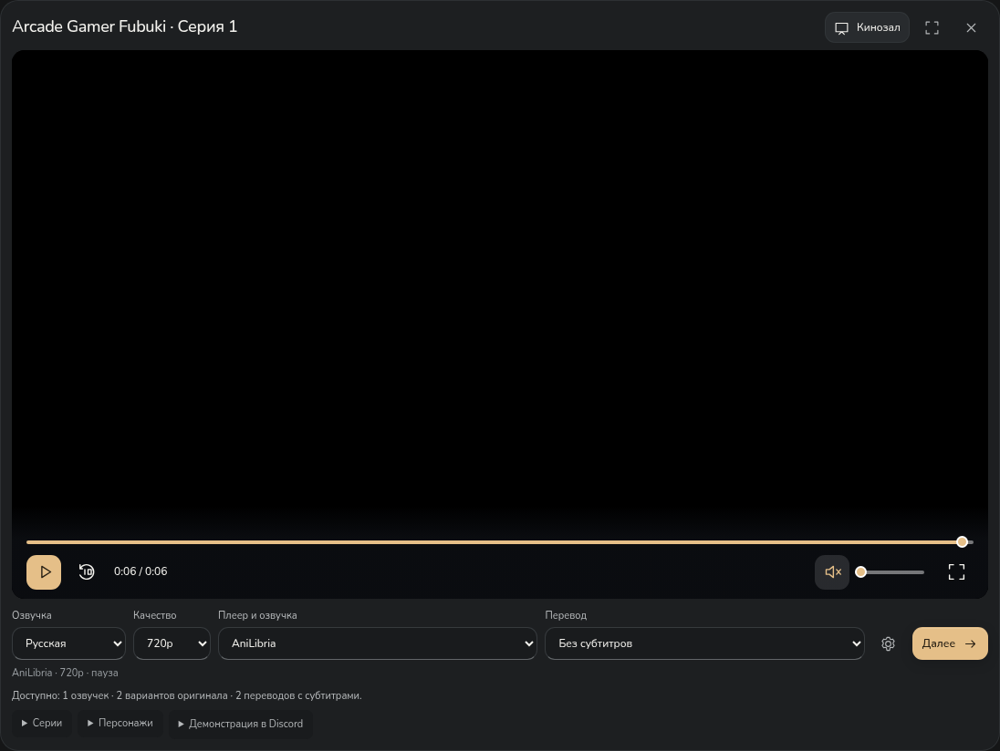
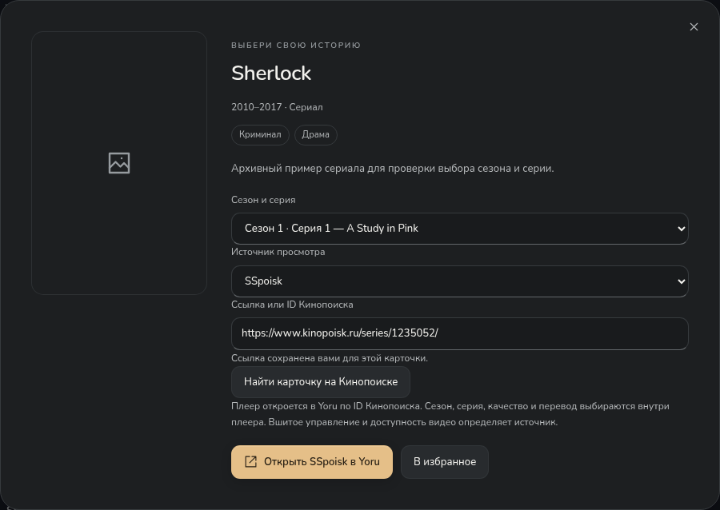
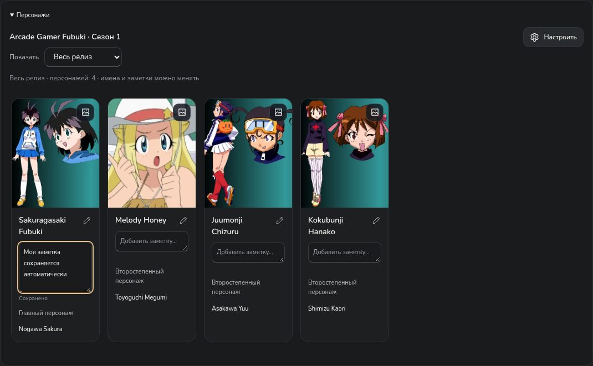
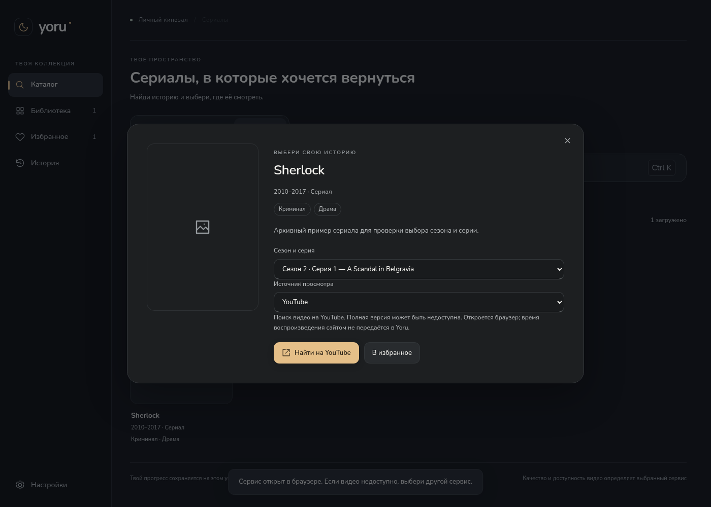
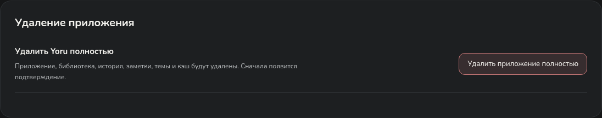

# Yoru — кино, сериалы и аниме


**Windows 10/11 · x64 · версия 0.9.6**

Три раздела в одном приложении: **Аниме / Фильмы / Сериалы**. Поиск, жанры, избранное, библиотека, темы и сохранение позиции встроенного просмотра.

Для аниме AniLibria доступен встроенный плеер и автоматический подбор дополнительных озвучек/переводов Yummyani для сопоставленного релиза. Выбранный онлайн-плеер открывается на странице просмотра Yoru. Расширенный каталог Yummyani подгружает следующие страницы при прокрутке и открывает поддерживаемый плеер **внутри Yoru**, с выбором серий, автопереходом и сохранением подтверждённого тайминга. Для фильмов и сериалов доступны каталог и плееры **CX, SBS, CFD, SSpoisk, KinoKino** по точной карточке Кинопоиска; они открываются в отдельном окне Yoru. Поиск в **YouTube, Кинопоиске, Rutube, VK Видео** сохранён отдельно. Доступность полной версии и региональные ограничения определяет источник. Подтверждённые прямые файлы Internet Archive можно смотреть внутри приложения с резервными адресами того же файла.



Новые киносервисы пока **не подтверждены живой проверкой из РФ и других стран**. В этой облачной среде их домены отклоняются прокси; сетевой черновик сохранён и ожидает публикации. Тесты с контролируемыми ответами проверяют приложение, но не заменяют проверку внешнего видео.

## Установка

**[Скачать Yoru 0.9.6 — установочный EXE](https://github.com/Duwkaf1/nydanyda/releases/download/v0.9.6/Yoru-Setup-0.9.6-x64.exe)** — около 108 MiB, **без входа в GitHub**. Закрой прежний Yoru, запусти EXE и нажми «Установить». Библиотека и настройки сохраняются; права администратора не нужны.

[Страница релиза](https://github.com/Duwkaf1/nydanyda/releases/tag/v0.9.6) · [ZIP без установки](https://github.com/Duwkaf1/nydanyda/releases/download/v0.9.6/Yoru-windows-x64.zip) · [Исходники ZIP](https://github.com/Duwkaf1/nydanyda/archive/refs/tags/v0.9.6.zip) · [Инструкция](docs/installer.md) · [Успешная Windows-проверка](https://github.com/Duwkaf1/nydanyda/actions/runs/41382539523)

## Полный экран и источники кино 0.9.6

Исправлен отказ Electron в разрешении `fullscreen` и ограничение высоты кинозала. Кнопка полного экрана, **F11** и **Esc** работают с обоими движками, аниме-iframe и отдельными окнами плееров; источник, пауза и позиция сохраняются. Разрешения камеры/микрофона и прочие возможности сайтам не выдаются.

В карточке фильма или сериала выбери **«Источник просмотра»**: CX, SBS, CFD, SSpoisk или KinoKino. Автоподбор использует точное совпадение IMDb с единственной карточкой КП. Если его нет, вставь ссылку Кинопоиска либо ID — привязка сохранится для этого названия. Сезон/серия, качество и перевод выбираются внутри источника. Поиск в обычных сервисах остаётся отдельным вариантом.



Пример ID на снимке взят из сообщения пользователя и не объявляется подтверждённым соответствием Sherlock. Доступность самих зеркал живым видео ещё не подтверждена: текущая сеть среды блокирует их. [Возможности, проверки и ограничения 0.9.6](docs/fullscreen-cinema-0.9.6.md).

Старые красные уведомления Actions относятся к предыдущим запускам. После них №35–37 прошли. Репозиторий переименован в **Duwkaf1/nydanyda** и публичен. Новые установщики публикуются в **GitHub Releases** после проверки контрольной суммы и Windows-установки; для скачивания Releases аккаунт не нужен. Исходные тексты также доступны публично.

## Проверка популярных аниме 0.9.5

Проверены живые метаданные 13 релизов Naruto Shippuden, One Piece, Bleach, Demon Slayer и Jujutsu Kaisen. Основной Attack on Titan в проверенных запросах AniLibria не найден; школьный спин-офф не принят за него. У «Квартала красных фонарей» исправлено расхождение года карточки (2021) и зимнего сезона в индексе (2022): точный MAL 47778 и совпадающее название теперь проходят проверку. Допуск соседнего года не распространяется на другие аниме.

Это проверка идентичности релиза. Отдельные появления персонажей по сериям у этих TV пока не подтверждены и не подключены: нужные Wiki закрыты действующей облачной сетью. Общий каст не выдаётся за список серии. [Таблица и границы проверки](docs/popular-cast-0.9.5.md) · [Живые ответы каталога](docs/popular-cast-0.9.5.json). Интерфейс 0.9.4 сохранён.

## Панель просмотра и персонажи серии 0.9.4

Своя панель Yoru управляет воспроизведением, временем, перемоткой, звуком и полным экраном. У встроенного плеера сайта шестерёнка открывает его настройки качества и перевода; кнопка «Панель Yoru» возвращает управление. В Electron состояние берётся у реального HTML5-видео, в том числе во вложенном iframe без API провайдера. Удалённый плеер не получает Node/IPC, а URL потока и токены не извлекаются.

Зависание не дальше 1,25 секунды до конца после 8 секунд без движения завершает серию. Нужны подтверждённые время и длительность от 30 секунд, а также намерение продолжать просмотр. Ручная пауза блокирует переход; настройка автоследующей серии учитывается. Запоздалые состояния плеера не отменяют нажатие паузы или продолжения. Обычное окончание переключает серию сразу.

«Оригинал» больше не остаётся подписью русского источника после неудачного подбора. Проверяется текущий API Yummyani, второе название и подтверждённые издания того же релиза; поддержаны опубликованные Sibnet и обёртки Yummyani. Адреса не строятся подстановкой одного ID во все сервисы.

У персонажей есть быстрый выбор **«Весь релиз / Эта серия»**. Для TV «Чёрный клевер» (MAL 34572) добавлен отдельный адаптер списка появлений Episode N в Black Clover Wiki. Имена сопоставляются с кастом релиза; ручные отметки подписаны отдельно. Для релизов без подтверждённых появлений предлагается общий каст с явной подписью. Живые ответы Wiki и наличие японских дорожек пока не подтверждены из-за сетевой политики среды. [Подробности и границы проверки](docs/player-chrome-0.9.4.md).

## Озвучка, переводы и реклама

В плеерах включён **офлайн-адблок Ghostery с EasyList/RU AdList/uBlock**: рекламные запросы и всплывающие окна блокируются, IMA/VAST получают локальные совместимые ответы. При запуске не требуется скачивать фильтры. Исходники, ревизии, контрольные суммы и лицензии включены в поставку. [Подробности](docs/player-protection-0.9.3.md) · [Фильтры и лицензии](data/adblock/README.md). Вшитую в сам файл рекламу сетевой блокировщик удалить не может.

Каталог получает по 24 карточки за запрос и автоматически загружает продолжение при прокрутке. Счётчик показывает загруженную часть, а не ограничивает весь каталог. Просмотр Yummyani остаётся на странице Yoru; неподдерживаемый плеер не заменяется окном сайта. [Подробности 0.9.2](docs/managed-anime-0.9.2.md).

Под видео выбери **«Озвучка → Оригинал»** — приложение подберёт другой подтверждённый плеер той же серии. Если переводов ещё нет, в поле **«Перевод»** есть **«Найти оригинал с субтитрами»**. При отсутствии варианта русское видео приостанавливается и появляется результат с повтором. Опубликованные варианты выбираются непосредственно в списке. Поле **«Плеер и озвучка»** появляется, когда у серии есть несколько вариантов. Названия студий и команд берутся из API; вставлять ссылки не требуется. AniLibria начинает играть сразу, другие варианты подбираются в фоне. При восстановлении выбранного оригинала другой русский дуб не включается на время ожидания.

[Снимок страницы просмотра](docs/images/automatic-player.png) использует собственный тестовый ролик и контролируемые варианты, не живое видео аниме.

У онлайн-плеера разрешение и оформление субтитров выбираются **в самом плеере**. Yoru показывает «В плеере»; подтверждённое API максимальное разрешение указано в подписи варианта. Встроенные основной/альтернативный движки, прямые видео и оформленные субтитры сохранены. В настольной версии тайминг берётся у реального видео, а Kodik API служит резервом. Если ни видео, ни поддерживаемый API недоступны, управление не объявляется подтверждённым.

Персонажи и фотографии для сопоставленного релиза загружаются из **AniDB автоматически**, без XML и регистрации API-клиента пользователем. Быстрые запросы ждут в очереди. При отказе или изменении разметки AniDB используется **MyAnimeList через Jikan**, затем независимый **AniList**. Проверяются точный MAL ID, каноническое имя и год исходного релиза в индексе. Даты фестивального показа и выпуска могут различаться; это не разрешает подменять спешл телевизионным сезоном. Источник обозначается в интерфейсе; ID персонажей трёх каталогов не смешиваются. Главные роли идут перед второстепенными. Свои имена и заметки сохраняются. Общий каст относится к релизу. Режим «Эта серия» использует отдельные подтверждённые появления, каст одноэпизодного релиза либо твои явно подписанные ручные отметки.



Для **«Чёрного Клевера (Спэшл)», AniLibria 5152**, проверен настоящий ответ: только **720p/480p**, 1080p у этого источника нет. Также исправлена отдельная ошибочная связь карточки с другим спин-оффом. У другого плеера 1080p доступно только если оно действительно опубликовано. [Данные проверки](docs/black-clover-0.9.1.json).

**Живая проверка дополнительных озвучек, субтитров и актуальных ответов AniDB/Jikan/AniList ещё не завершена:** действующая политика облачной сети не разрешает эти домены. Сетевой черновик сохранён и требует публикации в настройках среды. Контролируемые тесты проверяют код, а не наличие оригинала/переводов у каждого аниме. [Подробности и ограничения 0.9.4](docs/player-chrome-0.9.4.md).

## Фильмы и сериалы

- Cinemeta: названия, описания, год, жанры, постеры и серии. Список жанров берётся из выбранного каталога.
- При отказе основного каталога — TVmaze для сериалов или Internet Archive для свободных фильмов. Смена источника обозначается; состав каталогов различается.
- Поиск на YouTube, Кинопоиске, Rutube и VK Видео получает название, год и выбранную серию. Переход в браузер позволяет сервису самостоятельно обработать вход, подписку и DRM.
- При недоступности каталога введённое название можно искать сразу на выбранном сервисе.
- Встроенный просмотр Internet Archive предлагается только при подтверждённых метаданных лицензии, языка и подходящего файла. Резервные адреса используют то же имя файла, MD5 и качество; прогресс восстанавливается только для того же файла.
- **Настройки → Дополнительно → Доступ к видеосервисам**: проверка соединения с публичными страницами без учётных данных. Она не подтверждает наличие или воспроизведение конкретного фильма.

**Автоматической передачи тайминга и озвучки между браузерными плеерами этих сервисов нет.** Сервисы выбираются вручную; история встроенного плеера не выдаётся за историю браузера. Доступность всех фильмов и непрерывность просмотра при полном отказе сети не гарантируются.



[Подробности 0.9.0 и ограничения проверки](docs/cinema-0.9.0.md) · [Прямой просмотр свободного фильма — тестовый пример](docs/images/cinema-archive.png) · [Резерв поиска при отказе каталогов](docs/images/cinema-fallback.png)

## Каталог аниме

- Плавный поиск: неподходящие карточки исчезают при вводе, оставшиеся перестраиваются. Уменьшение движения и режим производительности учитываются.
- До шести жанров, возрастной рейтинг, сброс фильтров и случайное аниме со всеми выбранными условиями. Возраст и жанры видны на карточках.
- Выбор между AniLibria и расширенным каталогом Yummyani.
- Поиск по названию, разделы **«Популярное», «Обновления», «Новинки»**, подгрузка следующих карточек.
- Карточка аниме с постером, описанием, жанрами, выбором доступной серии и избранным.
- Автоматическое добавление просмотренного аниме в библиотеку и история с продолжением на сохранённой серии и позиции.
- Основной и альтернативный плееры; переключение сохраняет позицию, паузу и звук.
- Качество выбирается из реально доступных вариантов. Перед повторным открытием обновляются временные адреса видео, чтобы старые ссылки не мешали запуску.
- При ошибке — понятное сообщение и повторная попытка. Отдельной страницы «Источники» с обязательными проверками больше нет.

Для встроенного просмотра подключён **каталог AniLibria/AniLiberty**: в живой проверке 25 октября 2026 года API вернул **1 904 релиза** с русской озвучкой. Это каталог этого провайдера, а не всех аниме мира. Часть релизов может иметь неполный список доступных серий или ограничения; приложение показывает фактическую доступность. Другие студии и оригинальная дорожка не приписываются этому провайдеру.

В поле **«Где искать» → «Yummyani»** доступен дополнительный каталог с поиском, жанрами, возрастами и случайным выбором. Нужная страница открывается кнопкой **«Смотреть на Yummyani»** в отдельном изолированном окне Yoru. Озвучки, серии, субтитры и прогресс там контролирует сайт; синхронизации с таймингом встроенного плеера нет. Точное общее число API этого сайта не сообщает, поэтому показывается число загруженных карточек.


[Фильтры и расширенный каталог](docs/catalog-0.8.1.md). Если постер Yummyani не загрузился, приложение запрашивает резервную обложку AniLibria или MyAnimeList/Jikan по точным идентификаторам релиза. Одного совпадения названия недостаточно: конфликтующие ID и неподтверждённый сезон оставляют заглушку. [Подробности 0.8.2](docs/release-0.8.2.md).


В живой проверке основной CDN намеренно отключён, а метаданные и резервные картинки загружены из настоящих сервисов. Проверены «Фрирен» и «Клинок, рассекающий демонов». Внешние метаданные могут содержать ошибки; автоматический подбор по похожему названию не используется. [Результаты](docs/live-posters-0.8.2.json).


[«Клинок, рассекающий демонов» через альтернативный плеер](docs/images/catalog-live-player-alternative.png) · [Как проверены поиск и фильтры](docs/catalog-0.8.1.md)

## Оформление и удобство

Пять готовых тем — **«Тёплая ночь», OLED, «Север», «Сакура», «Молочный»** — и **«Своя»** с цветами фона, панелей, текста, акцента и формой элементов. Личный выбор сохраняется при переключении тем.

В 0.8.0 исправлены форма и центрирование месяца. Собственная палитра автоматически получает читаемый текст на каждой поверхности, включая поля и боковую панель. Включённое по умолчанию **«Смягчать яркие фоны»** делает большие цветные поверхности спокойнее; переключатель позволяет оставить точные цвета. Исходные значения в палитре сохраняются в обоих случаях, исправление контраста работает всегда.

Ползунок **«Производительность → Баланс → Качество»** плавно следует за мышью и мягко останавливается на выбранном режиме. Клавиатура переключает режимы целиком. Описания не сдвигают ползунок при смене режима на узком окне.

- Производительность отключает декоративные эффекты и анимации, уменьшает количество карточек библиотеки и лимиты памяти медиакомпонентов.
- Качество добавляет мягкие переходы, объём обложек и танцующую пиксельную Мику в индикатор ожидания видео.
- Разрешение видео настраивается отдельно. Изменение оформления не перезапускает текущую серию.
- Локальный шрифт Nunito с кириллицей, SVG-иконки, прокрутка справа, клавиатурный фокус и поддержка уменьшения движения.


[Все 58 скриншотов](docs/images/README.md) · [Плавный ползунок](docs/images/performance-smooth.png) · [Пример формы элементов](docs/images/settings-radius-preview.png)

## Полное удаление

В установленной Windows-версии: **Настройки → Дополнительно → Удалить приложение полностью**. Системное окно перечислит удаляемые данные; по умолчанию выбрана **«Отмена»**. После подтверждения приложение закроется, а деинсталлятор удалит Yoru, библиотеку, историю, заметки, темы и кэш. Вернуть эти локальные данные после удаления нельзя.

Обычное удаление через настройки Windows сохраняет профиль. Посторонние файлы в папке установки и цели ссылок из профиля не удаляются. В ZIP без установщика и при запуске с отдельным профилем полное удаление из приложения недоступно.



## Сохранённые возможности

У каждого аниме свои прогресс, заметки и имена персонажей. Персонажи сопоставленного релиза автоматически загружаются с AniDB; главные роли показаны перед второстепенными. Ручной XML/API и собственная привязка сохранены в дополнительных настройках. Полный состав каждой серии и каждого релиза не гарантируется.

Для собственной библиотеки сохранены дополнительные прямые MP4/WebM/HLS-источники, оригинальная озвучка, несколько переводов и текстовые/оформленные субтитры. Ручное добавление и импорт находятся в **Настройки → Дополнительно → данные библиотеки** и не нужны для каталога. Дополнительный импорт прежних ручных ссылок сохранён отдельно от просмотра каталога.

**30 секунд без продвижения видео** запускают переход к доступному резервному источнику той же серии и озвучки, затем учитывается сохранённый приоритет русских студий. Качество не снижается автоматически. Это работает при наличии подходящих резервных источников; единственный поток не превращается в несколько независимых плееров. Ручная пауза не считается сбоем.

[Восстановление просмотра](docs/recovery-0.7.7.md) · [Имена и заметки](docs/character-details.md) · [Субтитры и дополнительные источники](docs/viewing-0.6.md)

## Проверки версии 0.9.6

Код приложения и установщика — [`f31d5cb`](https://github.com/Duwkaf1/nydanyda/commit/f31d5cb75b651ae52c465fe1859ae760b51f174a).

- **125 unit-тестов**, production build и настоящий Linux Electron прошли.
- **136 браузерных сценариев прошли за 6,9 минуты** на финальном коде. Проверены полный экран в кинозале, F11/Esc, оба движка и iframe, привязка КП по точному ID, пять зеркал, недоступный автоподбор и поздний ответ предыдущей карточки.
- **[Windows CI успешен](https://github.com/Duwkaf1/nydanyda/actions/runs/41382539523)**: unit/build, реальный Electron, упаковка, установка и запуск установленного EXE, повторный полный экран, обновление, обычное/полное удаление, отмена, сохранность посторонних файлов/junction и кириллический путь.
- Этап публикации сверил SHA-256 и загрузил публичные файлы Releases. Запросы без Authorization получили JSON релиза и EXE (HTTP 206, первые байты `MZ`); размер, GitHub digest и публичный файл SHA-256 совпали.

Установщик: **113 483 155 байт**, SHA-256 `531a5ea3cc69bb0c2f1db3d7ef22993f3180d59f29d07a925563faf11680ea17`. [61 снимок](docs/images/README.md): 55 обновлены полным прогоном; шесть исторических живых снимков сохранены отдельно.

Живое воспроизведение конкретных фильмов/серий на зеркалах пока не подтверждено из-за сетевых ограничений среды. Автоматическое управление их сезоном/серией/таймингом не объявляется готовым: выбор выполняется внутри источника. Подбор KP ID требует точного IMDb, иначе доступна пользовательская ссылка.

[Отчёт 0.9.6](docs/fullscreen-cinema-0.9.6.md) · [Журнал проверок](docs/validation.md) · [Предыдущая версия 0.9.5](docs/popular-cast-0.9.5.md)

## Запуск из исходников

Нужен **Node.js 24**.

```sh
npm ci
npm test
npm run build
npm start
```

```sh
npm run test:e2e
npm run test:desktop
npm run installer:win
```

Для установщика нужен бесплатный NSIS 3.11. `npm run package:win` собирает папку Windows-приложения. В облачной среде с унаследованным прокси используй `NODE_USE_ENV_PROXY=1`; TLS и проверка сертификатов остаются включены. Для Linux Electron нужен графический дисплей; браузерным тестам нужны Chromium и FFmpeg. [Сборка установщика](docs/installer.md).

## Данные и лицензии

Настройки, библиотека и заметки хранятся локально. Прежний профиль `kadr-anime` сохранён для совместимости. Временные адреса видео каталога не сохраняются в постоянной библиотеке: приложение запрашивает их заново перед просмотром.

В `data/` опубликован производный индекс 13 656 связей MAL/AniDB из anime-offline-database 2026-27, ODbL-1.0 / DbCL-1.0; исходная ссылка, контрольные суммы и лицензия включены. Код приложения не заимствован из сторонних клиентов.

Платные библиотеки не добавлены. Лицензии Electron, HLS.js, Video.js, libass-wasm и включённых шрифтов сохраняются в поставке. Nunito — SIL OFL. Постеры и кадры аниме принадлежат правообладателям; тестовые медиа и архивные изображения не включены в установщик.
